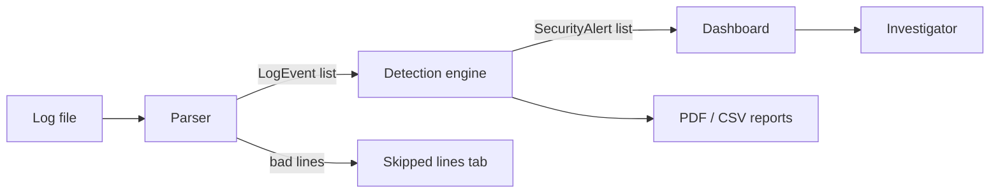
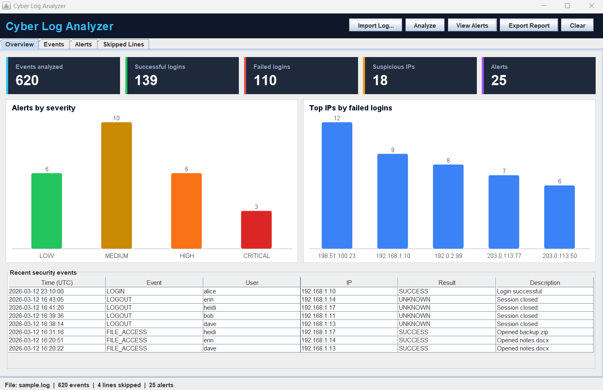
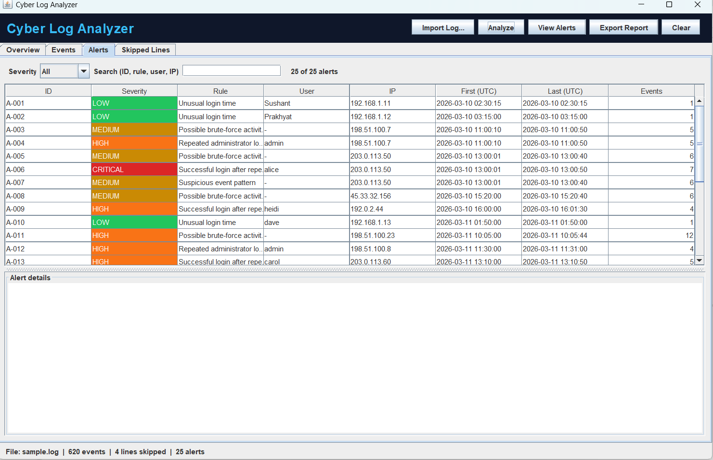
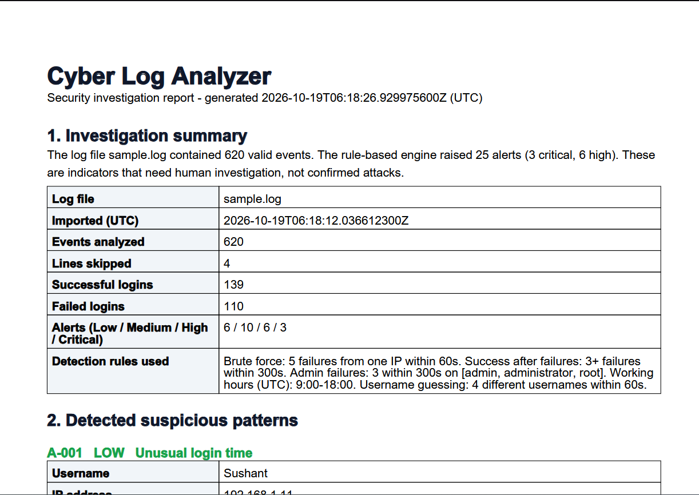

<div align="center">

# 🛡️ Cyber Log Analyzer

**A Java desktop tool that turns raw login logs into explainable security alerts.**


[Features](#-features) · [Quick start](#-quick-start) · [How it works](#-how-it-works) · [Detection rules](#-detection-rules) · [Screenshots](#-screenshots) · [Testing](#-testing) · [Roadmap](#-roadmap)

</div>

---

## 📌 Overview

Cyber Log Analyzer imports authentication logs, parses them into structured events, runs five rule-based detections (brute force, password guessing, admin attacks and more), and shows everything on a modern dashboard. Every alert explains **why** it fired, what to do about it, and shows the **original log lines** as evidence. Findings can be exported as **PDF** or **CSV** reports.

> ⚠️ **Defensive use only.** Analyze the included sample logs or logs you are authorized to inspect. Alerts are indicators, not proof of an attack, and may be false positives.

## ✨ Features

| | |
|---|---|
| 📥 **Safe import** | `.log`, `.txt`, `.csv`; rejects empty, unreadable, oversized and unsupported files; malformed lines are skipped with a reason |
| 🔎 **Structured parsing** | Timestamp, event type, user, IP, result, description, and the original line kept for verification |
| 🚨 **5 detection rules** | Configurable thresholds, four severity levels, explanation and recommended action per alert |
| 📊 **Dashboard** | Stat cards, alerts-by-severity chart, top-IPs chart, recent events |
| 🔍 **Search and filters** | Text, user, IP, event type and date range on events; severity and text on alerts |
| 🧾 **Reports** | One-click PDF and CSV export with summary, evidence and limitations |
| 🔒 **Secure handling** | Logs are only read as text, never executed; CSV formula injection is neutralized |

## 🚀 Quick start

**Requirements:** JDK 17+ and Maven 3.8+ (`java -version`, `mvn -v` to check).

```bash
# 1. go to the folder that contains pom.xml
cd CyberLogAnalyzer

# 2. run the automated tests
mvn test

# 3. start the app
mvn compile exec:java
```

The app opens with `sample.log` already loaded.

### 🧭 Walkthrough
1. **Overview tab:** check the cards. Suspicious IPs and Alerts show `-` until you analyze.
2. Click **Analyze**. Cards, charts and the Alerts tab fill in.
3. Open the **Alerts** tab, filter by severity, and click a row to read why it was flagged and the evidence lines.
4. Open the **Events** tab to search the raw events (try `203.0.113` in IP, or a date range).
5. Click **Export Report** and choose PDF or CSV.
6. Use **Import Log...** for your own file, or **Clear** to reset.

## 🧠 How it works



| Layer | Package | Role |
|---|---|---|
| Model | `model` | `LogEvent`, `SecurityAlert`, `Severity` |
| Parser | `parser` | Regex-based line parser with strict timestamp and IP validation |
| Analyzer | `analyzer` | `RuleManager` (thresholds), `EventCorrelator` (grouping, rolling window), `DetectionEngine` (rules) |
| Reports | `reports` | `PDFReportGenerator`, `CSVReportGenerator` |
| UI | `ui` | `Dashboard`, `LogTablePanel`, `AlertPanel`, `BarChartPanel` (Java2D charts), `Theme` |

**Rolling window:** for each IP, failures are kept in time order with a left and right pointer. The left pointer moves forward while the window is longer than the time limit. When the window holds enough failures, an alert is raised, and overlapping windows are merged into one alert. After sorting this is linear time.

## 🎯 Detection rules

Defaults live in [`RuleManager.java`](src/main/java/analyzer/RuleManager.java); change a value there to tune a rule.

| Rule | Triggers when | Severity |
|---|---|---|
| **Possible brute-force activity** | 5+ failed logins from one IP within 60 s | 🟡 Medium, 🟠 High at 10+ |
| **Successful login after repeated failures** | Success from an IP with 3+ failures in the last 300 s | 🟠 High, 🔴 Critical at 5+ |
| **Repeated administrator failures** | 3+ failures on `admin`, `administrator` or `root` within 300 s | 🟠 High, 🔴 Critical at 6+ |
| **Unusual login time** | Successful login outside 09:00-18:00 UTC | 🟢 Low |
| **Suspicious event pattern** | 4+ different usernames tried from one IP within 60 s | 🟡 Medium, 🟠 High at 8+ |

### Example alert
```
A-005   CRITICAL   Successful login after repeated failures
IP: 203.0.113.50   User: alice   Events: 7
First: 2026-03-10 13:00:01 UTC   Last: 2026-03-10 13:00:50 UTC

Why flagged: A login succeeded from 203.0.113.50 after 6 recent failures,
so the account may have been guessed or compromised. This is an indicator,
not proof of an attack; it may be a false positive and needs investigation.

Recommended action: Verify the login with the account owner, reset the
password and review the session.

Evidence:
  Line 16: 2026-03-10 13:00:01 | LOGIN | root  | 203.0.113.50 | FAILURE | Invalid user
  ...
  Line 22: 2026-03-10 13:00:50 | LOGIN | alice | 203.0.113.50 | SUCCESS | Login successful
```

## 📄 Log format

One event per line, six fields separated by `|`:
```
timestamp           | EVENT_TYPE | user  | ip           | RESULT  | description
2026-03-10 11:00:10 | LOGIN      | admin | 198.51.100.7 | FAILURE | Wrong password
```
`RESULT` is `SUCCESS`, `FAILURE` or `N/A`. Use `-` for an unknown user or IP. Times are UTC. Blank lines and lines starting with `#` are ignored. A `.csv` file works only if it uses this same layout.

### Included sample logs
| File | Contents | Expected result |
|---|---|---|
| `src/main/resources/sample.log` | 24 hand-written lines plus 600 generated events with attack scenarios | about 620 events, 4 skipped, 25 alerts |
| `src/test/resources/small.log` | The original 24-line log used by the tests | 20 events, 4 skipped, 6 alerts |

## 🖼️ Screenshots

Add your own screenshots to `docs/screenshots/` and they will show here.

| Overview | Alerts | PDF report |
|---|---|---|
|  |  |  |

## 🧪 Testing

```bash
mvn test        # 30 tests, expected: Failures: 0
```

| Area | What is checked |
|---|---|
| Parser | valid lines, missing fields, bad timestamp, bad IP, garbage lines, comments and blanks |
| Detection | each rule triggers at its threshold, stays quiet below it, rolling window, severity, evidence, custom thresholds, unsorted input, time-of-day boundaries |
| Reports | CSV content, PDF validity, formula neutralization, empty reports |

## 🗂️ Project structure

```
CyberLogAnalyzer/
├── pom.xml
├── README.md
├── PROJECT_REPORT.md
└── src/
    ├── main/
    │   ├── java/
    │   │   ├── app/        Main.java
    │   │   ├── model/      LogEvent, SecurityAlert, Severity
    │   │   ├── parser/     LogParser, SampleLogParser, ParseResult
    │   │   ├── analyzer/   DetectionEngine, RuleManager, EventCorrelator
    │   │   ├── reports/    ReportData, CSVReportGenerator, PDFReportGenerator
    │   │   └── ui/         Dashboard, LogTablePanel, AlertPanel, BarChartPanel, Theme
    │   └── resources/      sample.log
    └── test/
        ├── java/           parser, analyzer, reports tests
        └── resources/      small.log
```

## 🔐 Security notes
- Log files are read as plain text only; nothing in them is executed, rendered as HTML or used in SQL.
- Passwords are not part of the log format and are never stored.
- CSV cells starting with `=`, `+`, `-` or `@` get a leading `'` so spreadsheets cannot run them as formulas.
- The app makes no network connections and uploads nothing.

## ⚠️ Limitations
- Only the documented pipe-separated format is supported (no Linux `auth.log` or Windows Event Log parsing yet).
- Nothing is saved between runs: no database, alert status or investigation notes.
- Thresholds are edited in source code, not in the UI.
- IPv4 only.
- Rule-based detection can miss slow attacks and can raise false positives.

## 🗺️ Roadmap
- [x] Parser with validation and skipped-line reporting
- [x] Five detection rules with rolling window
- [x] Dashboard with charts and filters
- [x] PDF and CSV reports
- [ ] SQLite storage with JDBC prepared statements
- [ ] Alert status (Open / Under Investigation / Resolved) and notes
- [ ] SHA-256 hashing of imported files
- [ ] Parsers for Linux `auth.log` and Windows Event Log
- [ ] Threshold editor in the UI and time-series charts

## 👤 Author
Prakhyat Raj Gupta · Computer Engineering · [GitHub profile](https://github.com/prakhyatg17/CyberLog-Analyzer)
